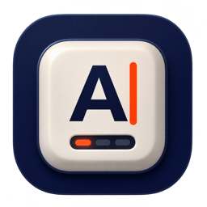
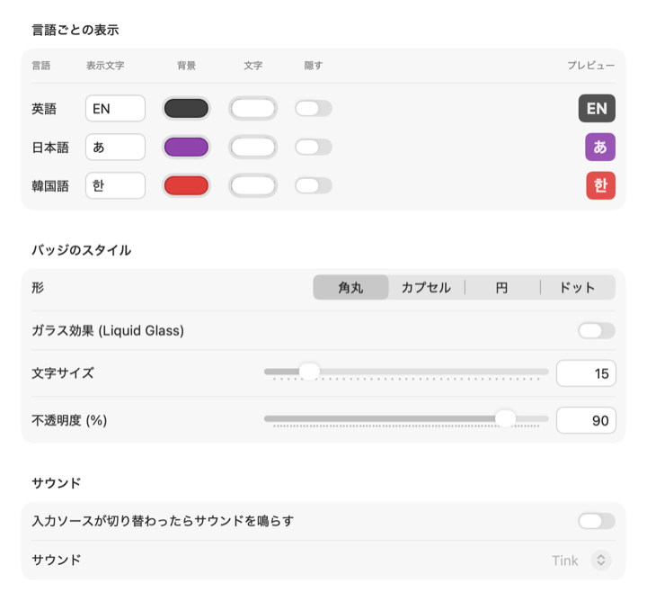
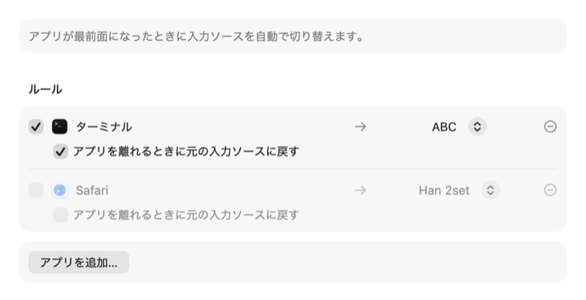

<p align="center"></p>

<h1 align="center">CheatIME</h1>

<p align="center">
どの言語で入力していても、現在の入力言語を macOS の画面に常に表示するバッジアプリです。<br>
<a href="README.md">English</a> · <a href="README.ko.md">한국어</a> · <b>日本語</b> · <a href="README.zh-CN.md">简体中文</a>
</p>

複数の言語で入力しながら、ターミナルや Vim などの CLI ツールで作業することが多い人なら、こんな経験があるはずです。ショートカットを押しても反応がなく、そこで初めて入力ソースが別の言語のままだったと気づく。CheatIME は画面に小さなバッジを表示して、今の入力言語をひと目で分かるようにします。特定のアプリに移ったときに、入力ソースを自動で切り替えることもできます。

<p align="center"></p>

## 機能

**バッジ**
- すべての操作スペースで、フルスクリーンアプリの上にも常に表示されます。
- 入力メソッドではなく言語で判別するため、言語や提供元を問わず、どの入力ソースでも使えます。
- 韓国語、日本語、英語には表示文字と色があらかじめ設定されています。それ以外の言語は、設定を変えるまで言語コード（例：ZH、RU、AR）で表示します。
- 言語ごとに表示文字、背景色、文字色を設定でき、特定の言語ではバッジを隠すこともできます。リストの並べ替えや削除ができ、新しく追加した入力ソースの言語は自動でリストに加わります。
- 形（角丸、カプセル、円、ドット）、文字サイズ（ドットではドットサイズ）、不透明度、枠線（実線、破線、点線）を変えられます。macOS 26 以降ではガラス効果（Liquid Glass）も使えます。
- バッジを常に表示するか、入力ソースが切り替わったときだけ一時的に表示するかを選べます。表示時間も調整できます。
- 入力ソースが切り替わったときに、好きなシステムサウンドを鳴らせます（macOS 標準にはない機能です）。

**表示位置**
- 下の 3 つの表示位置は、いくつでも同時にオンにできます。たとえば画面の隅に固定したバッジと、テキストカーソルの横のバッジを同時に表示できます。スタイルと表示タイミングはデフォルトに従い、表示位置ごとに「デフォルトに従う」をオフにすると、形、サイズ、不透明度、枠線、ガラス効果、表示タイミングを個別に設定できます。
- 固定位置：3×3 の配置と余白で位置を決めます。すべてのディスプレイ、ポインタがあるディスプレイ、選んだディスプレイのいずれかに表示できます。バッジをドラッグして動かすこともできます。
- ポインタの横：バッジがマウスポインタについて動きます。
- テキストカーソルの横：テキストカーソルのすぐ横にバッジを表示します。アクセシビリティへのアクセス許可（macOS 27 では「デバイスの制御とデータへのアクセス」）が必要です。一部のターミナルなど、テキストカーソルの位置を取得できないアプリでは、代わりにポインタの横に表示できます（オプションでオフにできます）。「ポインタの横」もオンの場合は表示しません。

**アプリ**
- チェックしたアプリが最前面にあるときだけバッジを表示します。チェックしたアプリはリストの先頭にまとめて表示されます。
- 自動切り替えルール：アプリが最前面になったら、選んだ入力ソースに切り替えます。ルールごとに、アプリを離れるときに元の入力ソースに戻すこともできます。

**その他**
- バッジをクリックすると非表示になり、右クリック（または Control キーを押しながらクリック）でメニューを開きます。
- ログイン時に自動で起動できます。
- 設定ウインドウとメニューは日本語、英語、韓国語で表示できます。通常はシステムの言語に従い、設定 → 一般で変更できます。これはアプリ自体の表示言語のことで、バッジはあらゆる言語の入力ソースで動作します。
- ネットワーク通信は行わず、キー入力も読み取りません。

<p align="center"></p>
<p align="center"></p>

## 動作環境

macOS 15 Sequoia 以降。Apple シリコンと Intel Mac の両方に対応しています（ユニバーサルバイナリ）。

## インストール

1. [Releases](https://github.com/HikiJun97/CheatIME/releases) から `CheatIME-<バージョン>.dmg` をダウンロードします。
2. DMG を開き、**CheatIME**を**Applications**にドラッグします。
3. CheatIME は Apple の公証を受けていないため、初回起動時に macOS にブロックされます。次のいずれかの方法で許可してください。
   - CheatIME を一度開きます。ブロックされたら**システム設定 → プライバシーとセキュリティ**を開き、CheatIME についてのメッセージの横にある**このまま開く**をクリックし、確認ダイアログで許可します。
   - または、ターミナルで次のコマンドを実行します。
     ```sh
     xattr -dr com.apple.quarantine /Applications/CheatIME.app
     ```

ログイン時に自動で起動するには、設定 → 一般で**ログイン時に開く**をオンにしてください。

## 使い方

- **メニューバーアイコン**：設定…（⌘,）、バッジを表示、CheatIME を終了
- **バッジ**：クリックで非表示、ドラッグで移動、右クリックでメニューを表示
- メニューバーアイコンがノッチに隠れている場合や、システム設定でメニューバーへの表示をオフにしている場合は、Spotlight や Finder から CheatIME をもう一度開くと設定ウインドウが表示されます。

### アクセシビリティへのアクセス

**テキストカーソルの横**を使うときだけ必要です。設定 → バッジ → **テキストカーソルの横**で表示をオンにし、**システム設定 → プライバシーとセキュリティ → アクセシビリティ**（macOS 27 では**デバイスの制御とデータへのアクセス**）で CheatIME を許可してください。

CheatIME は Apple Developer ID で署名していないため、macOS はバージョンが変わるたびに別のアプリとして扱います。アップデートしたら、このリストから CheatIME を削除して、もう一度許可してください。

## ソースからビルド

Xcode、または macOS 27 SDK を含む Command Line Tools（Swift 6.2 以降）が必要です。

```sh
git clone https://github.com/HikiJun97/CheatIME.git
cd CheatIME
make            # CheatIME.app をビルド（ユニバーサル）
make install    # /Applications にコピーして起動
make dist       # dist/ に DMG と ZIP を作成
```

## アンインストール

CheatIME を終了し、`/Applications/CheatIME.app` を削除します（`make uninstall` でも削除できます）。設定も消す場合は、次のコマンドを実行します。

```sh
defaults delete io.github.hikijun97.cheatime
```

**ログイン時に開く**をオンにした場合やアクセシビリティへのアクセスを許可した場合は、システム設定の該当するリストからも CheatIME を削除してください。

## プライバシー

CheatIME は Text Input Sources API を使って、どの入力ソースが選択されているかを macOS に問い合わせ、ルールに当てはまるときに入力ソースを切り替えます。キー入力は監視せず、ネットワークにも接続しません。**テキストカーソルの横**を使う場合、アクセシビリティへのアクセスはテキストカーソルの位置を読み取るためだけに使います。設定は macOS 標準のユーザデフォルトに保存されます。

## ライセンス

[MIT](LICENSE)
