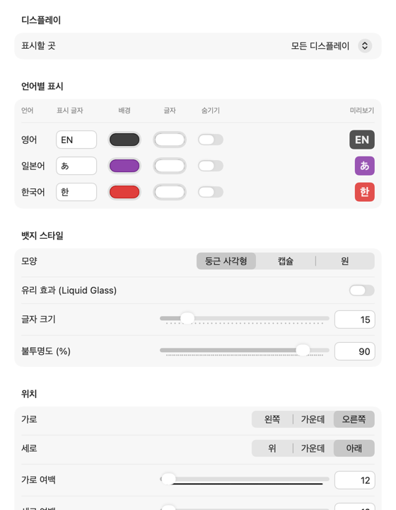
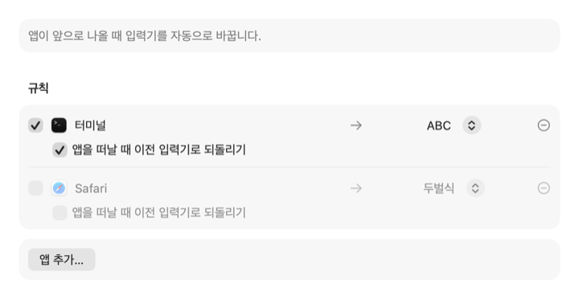

<p align="center"></p>

<h1 align="center">CheatIME</h1>

<p align="center">
지금 입력 언어를 macOS 화면에 항상 띄워 주는 뱃지 앱입니다.<br>
<a href="README.md">English</a> · <b>한국어</b> · <a href="README.ja.md">日本語</a> · <a href="README.zh-CN.md">简体中文</a>
</p>

터미널이나 Vim에서 단축키를 눌렀는데 입력기가 한글로 되어 있어서 당황한 적이 있다면, CheatIME가 지금 입력 언어를 한눈에 보여 줍니다. 앱마다 입력기를 자동으로 바꿔 주기도 합니다.

<p align="center"></p>

## 기능

- 전체 화면 앱을 포함해 모든 창 위에 떠 있습니다.
- 어떤 언어의 입력기든 함께 쓸 수 있습니다.
- 뱃지를 화면의 정해진 자리, 마우스 포인터 옆, 텍스트 커서 옆에 띄울 수 있고, 여러 곳에 동시에 띄울 수도 있습니다.
- 언어마다 표시 글자와 색을 정하고, 모양, 크기, 불투명도, 테두리, 유리 효과(Liquid Glass)를 고를 수 있습니다.
- 늘 띄워 두거나, 입력기가 바뀔 때만 잠깐 보이게 할 수 있습니다.
- 고른 앱에서만 뱃지를 띄울 수 있습니다.
- 어떤 앱이 앞으로 나오면 정해 둔 입력기로 자동으로 바꿉니다.
- 입력기가 바뀔 때 소리로 알려 주고, 로그인할 때 자동으로 실행할 수 있습니다.

<p align="center"></p>
<p align="center"></p>

## 요구 사항

macOS 15 이상, Apple Silicon 또는 Intel Mac

## 설치

1. [Releases](https://github.com/HikiJun97/CheatIME/releases)에서 `CheatIME-<버전>.dmg`를 내려받습니다.
2. DMG를 열고 **CheatIME**를 **Applications**로 끌어다 놓습니다.
3. CheatIME는 Apple 공증을 받지 않아서 처음 실행하면 macOS가 막습니다. 한 번 실행한 뒤 **시스템 설정 → 개인정보 보호 및 보안**에서 **그래도 열기**를 누릅니다. 터미널에서 다음 명령을 실행해도 됩니다.
   ```sh
   xattr -dr com.apple.quarantine /Applications/CheatIME.app
   ```

## 사용법

- **메뉴 막대 아이콘**: 설정…(⌘,), 뱃지 표시, CheatIME 종료
- **뱃지**: 클릭하면 숨기고, 끌면 옮기고, 우클릭하면 메뉴를 엽니다.
- 메뉴 막대 아이콘이 보이지 않으면 Spotlight나 Finder에서 CheatIME를 한 번 더 실행합니다. 그러면 설정 창이 열립니다.

**텍스트 커서 옆**에 띄우려면 손쉬운 사용 권한(macOS 27에서는 **기기 제어 및 데이터 접근**)이 필요합니다. **시스템 설정 → 개인정보 보호 및 보안 → 손쉬운 사용**에서 CheatIME를 허용합니다. 업데이트할 때마다 이 목록에서 CheatIME를 지우고 다시 허용해야 합니다.

## 소스에서 빌드

macOS 27 SDK(Xcode 또는 Command Line Tools)가 필요합니다.

```sh
git clone https://github.com/HikiJun97/CheatIME.git
cd CheatIME
make            # CheatIME.app 빌드
make install    # /Applications에 복사하고 실행
make dist       # dist/에 DMG와 ZIP 만들기
```

## 삭제

CheatIME를 종료하고 응용 프로그램 폴더에서 지웁니다(`make uninstall`로도 됩니다). 설정까지 지우려면 다음 명령을 실행합니다.

```sh
defaults delete io.github.hikijun97.cheatime
```

## 개인정보

CheatIME는 키 입력을 읽지 않고 네트워크에 연결하지 않습니다. 손쉬운 사용 권한은 텍스트 커서 위치를 찾는 데만 씁니다.

## 영감을 준 프로젝트

- [ShowyEdge](https://github.com/pqrs-org/ShowyEdge)
- [Input Source Pro](https://github.com/runjuu/InputSourcePro)

## 라이선스

[MIT](LICENSE)
