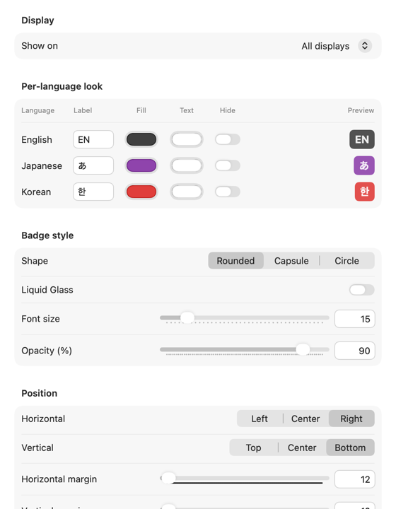

<p align="center"></p>

<h1 align="center">CheatIME</h1>

<p align="center">
An always-on-top badge that shows your current input language (한 / EN / あ) on macOS.<br>
<b>English</b> · <a href="README.ko.md">한국어</a> · <a href="README.ja.md">日本語</a> · <a href="README.zh-CN.md">简体中文</a>
</p>

If you type in more than one language and spend your day in a terminal, Vim, or other CLI tools, you know the pain: you press a shortcut, nothing happens, and only then do you notice the input source is still set to Korean, Japanese, or Chinese. CheatIME puts a small badge in a corner of the screen so you can tell your input language at a glance.

<p align="center"></p>

## Features

- Always-on-top badge that stays visible on every Space and over full-screen apps
- Works with any input method (Apple, Gureum, Kotoeri, and others) because it detects the language, not the input method
- Per-language label, background color, and text color, plus an option to hide the badge for specific languages
- Choose where it appears: all displays, the display with the pointer, or displays you pick
- Shape (rounded rectangle, capsule, circle), font size, opacity, and an optional Liquid Glass look (macOS 26 or later)
- Place it with a 3×3 alignment grid and margins, or simply drag the badge
- Click the badge to hide it; right-click (or Control-click) to open the menu
- Interface in English, Korean, and Japanese
- No permissions, no network access, and it never reads your keystrokes

<p align="center"></p>

## Requirements

macOS 15 Sequoia or later, on Apple silicon or Intel (universal binary).

## Install

1. Download `CheatIME-<version>.zip` from [Releases](https://github.com/HikiJun97/CheatIME/releases).
2. Unzip it and move `CheatIME.app` to `/Applications`.
3. CheatIME is not notarized by Apple, so macOS blocks the first launch. Allow it in one of these ways:
   - Open CheatIME once. After macOS blocks it, go to **System Settings → Privacy & Security**, click **Open Anyway** next to the CheatIME message, and confirm.
   - Or run this in Terminal:
     ```sh
     xattr -dr com.apple.quarantine /Applications/CheatIME.app
     ```

To start CheatIME automatically, add it in **System Settings → General → Login Items**.

## Usage

- **Menu bar icon**: Settings… (⌘,), Show Badge, Quit
- **Badge**: click to hide, drag to move, right-click for the menu
- If the menu bar icon is hidden (behind the notch, or turned off in **Allow in the Menu Bar**), open CheatIME again from Spotlight or Finder to bring up Settings.

## Build from source

Requires Xcode or the Command Line Tools with the macOS 27 SDK (Swift 6.2 or later).

```sh
git clone https://github.com/HikiJun97/CheatIME.git
cd CheatIME
make            # build CheatIME.app (universal)
make install    # copy to /Applications and launch
make dist       # create CheatIME-<version>.zip
```

## Uninstall

Quit CheatIME, delete `/Applications/CheatIME.app` (or run `make uninstall`), and optionally remove its settings:

```sh
defaults delete io.github.hikijun97.cheatime
```

## Privacy

CheatIME only asks macOS which input source is active, using the Text Input Sources API. It does not monitor keystrokes, needs no Accessibility or Input Monitoring permission, and makes no network connections. Settings are stored in the standard user defaults.

## License

[MIT](LICENSE)
