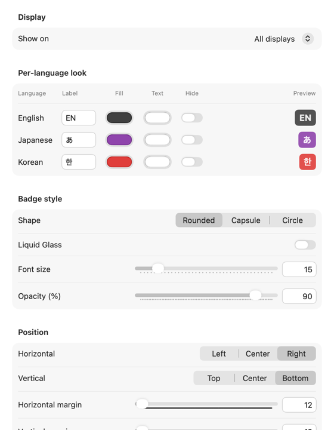

<p align="center"></p>

<h1 align="center">CheatIME</h1>

<p align="center">
在 macOS 上始终置顶显示当前输入语言的徽标应用。<br>
<a href="README.md">English</a> · <a href="README.ko.md">한국어</a> · <a href="README.ja.md">日本語</a> · <b>简体中文</b>
</p>

在终端或 Vim 里按下快捷键，才发现输入法还停在中文上？CheatIME 让你一眼看清当前的输入语言，还能在特定应用中自动切换输入法。

<p align="center"></p>

## 功能

- 始终显示在所有窗口上方，包括全屏应用
- 适用于任何语言的输入法
- 徽标可以固定在屏幕某处、跟随鼠标指针或显示在文本光标旁，也可以同时显示在多个位置
- 可为每种语言设置显示文字和颜色，并调整形状、大小、不透明度、边框和 Liquid Glass 效果
- 可以一直显示，也可以只在切换输入法后短暂显示
- 可以只在你选择的应用中显示
- 某个应用来到前台时，自动切换到指定的输入法
- 切换时可播放提示音，并支持登录时自动打开
- 可在应用内更新，第二次启动时会询问是否自动检查更新

界面提供英文、韩文和日文（暂无中文界面），下文的设置项名称以英文界面为准。

<p align="center"></p>
<p align="center"></p>

## 系统要求

macOS 15 及以上，Apple 芯片或 Intel 芯片的 Mac

## 安装

1. 从 [Releases](https://github.com/HikiJun97/CheatIME/releases) 下载 `CheatIME-<版本>.dmg`。
2. 打开 DMG，将 **CheatIME** 拖到 **Applications**。
3. CheatIME 未经过 Apple 公证，首次打开时会被 macOS 拦截。先打开一次，然后在**系统设置 → 隐私与安全性**中点按**仍要打开**。也可以在终端中运行：
   ```sh
   xattr -dr com.apple.quarantine /Applications/CheatIME.app
   ```

## 使用方法

- **菜单栏图标**：Settings…（⌘,）、Show Badge、Check for Updates…、Quit CheatIME
- **徽标**：点按隐藏，拖动调整位置，右键点按打开菜单
- 看不到菜单栏图标时，从 Spotlight 或访达再次打开 CheatIME，就会弹出 Settings 窗口。

**Next to Text Cursor**（文本光标旁）需要辅助功能权限（macOS 27 中为**设备控制和数据访问**）。请在**系统设置 → 隐私与安全性 → 辅助功能**中允许 CheatIME。如果是从 1.2.0 或更早版本更新，需要先从该列表中移除 CheatIME，再重新允许一次。

## 从源码构建

需要 macOS 27 SDK（Xcode 或 Command Line Tools）。首次构建时会下载 Sparkle 框架。

```sh
git clone https://github.com/HikiJun97/CheatIME.git
cd CheatIME
make            # 构建 CheatIME.app
make install    # 复制到 /Applications 并启动
make dist       # 在 dist/ 中生成 DMG 和 ZIP
```

## 卸载

退出 CheatIME，从“应用程序”文件夹中删除它（或运行 `make uninstall`）。如需同时删除设置，请运行：

```sh
defaults delete io.github.hikijun97.cheatime
```

## 隐私

CheatIME 不读取键盘输入，只在检查更新时连接 GitHub，可在 Settings → General 中关闭。辅助功能权限仅用于查找文本光标的位置。

## 灵感来源

- [ShowyEdge](https://github.com/pqrs-org/ShowyEdge)
- [Input Source Pro](https://github.com/runjuu/InputSourcePro)

## 许可证

[MIT](LICENSE)

更新功能使用 [Sparkle](https://sparkle-project.org)，其许可证随应用一同提供。
